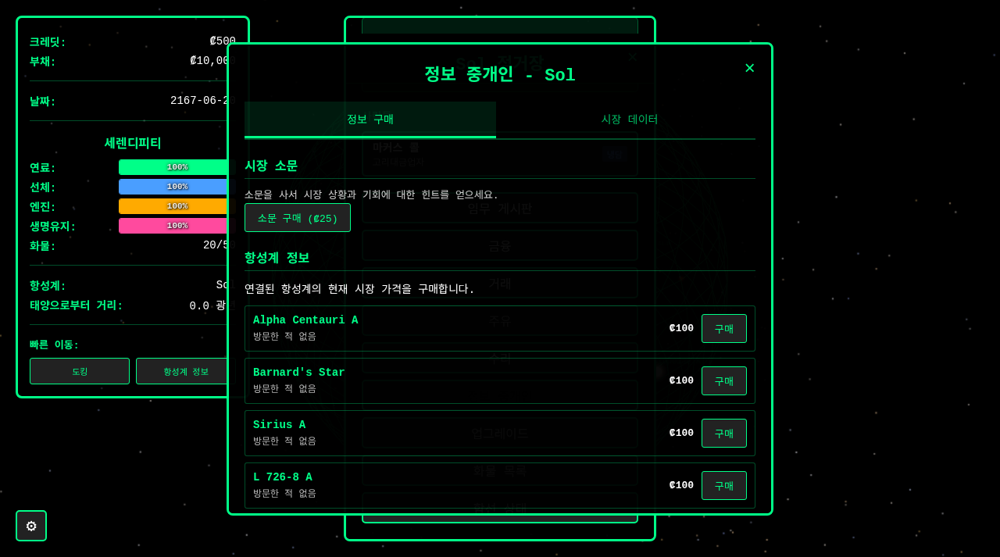
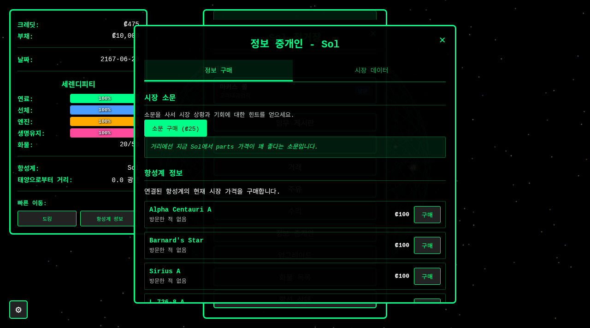
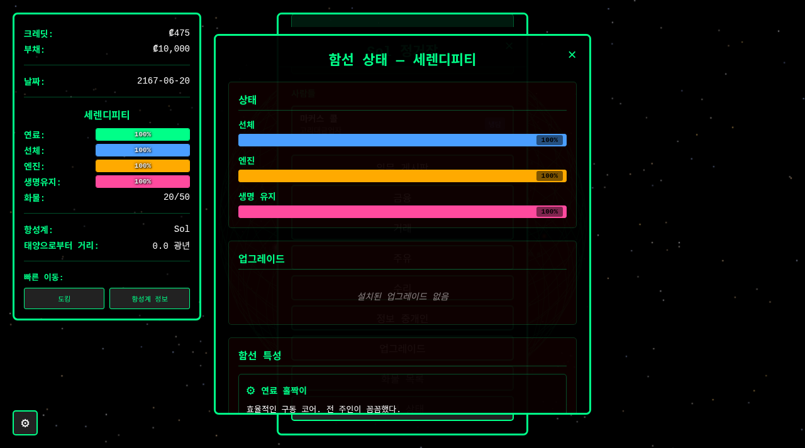
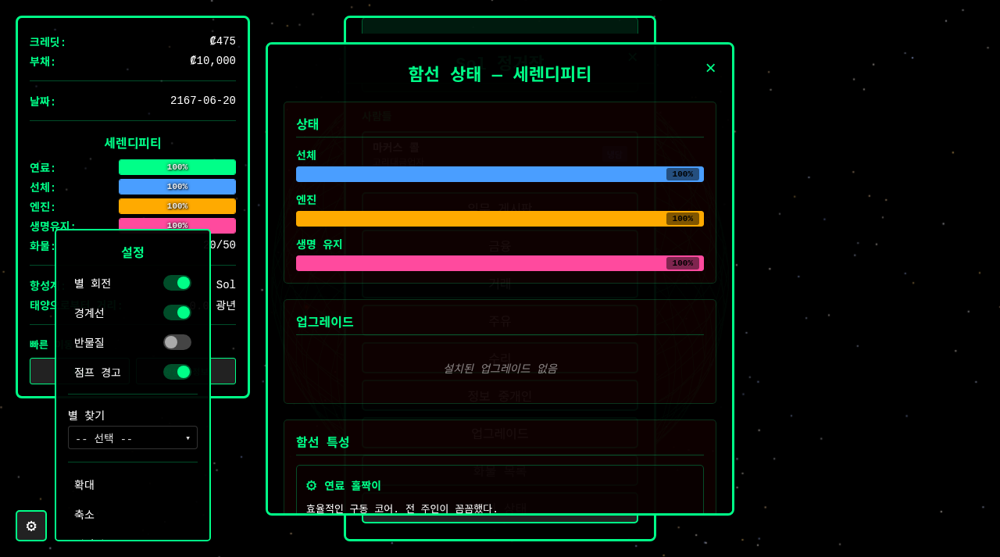

# 트램프 프레이터 블루스 (Tramp Freighter Blues) - 한글화

> 솔 섹터를 무대로 한 우주 교역 생존 게임의 **비공식 한글 번역판**입니다.

- **플레이하기:** https://sigco3111.github.io/tramp-freighter/
- **원작 저장소:** https://github.com/Ovid/tramp-freighter (제작: Curtis "Ovid" Poe)
- **원본 README:** [README.en.md](README.en.md)
- **라이선스:** MIT (원작 라이선스 [LICENSE.md](LICENSE.md)를 그대로 유지합니다)

## 게임 소개

117개의 실제 항성계, NPC와의 관계, 해적 전투, 분기형 대화, 다단계 퀘스트가 있는 우주 교역 생존 게임입니다. 작은 화물선 선장이 되어 빚을 갚고, 웜홀 네트워크를 오가며 거래하고, 언젠가 델타 파보니스로 향하는 것이 목표입니다.

## 스크린샷

| 정거장 정보 중개인 | 소문 구매 |
|---|---|
|  |  |

| 함선 상태 | 설정 |
|---|---|
|  |  |

## 게임 특징

- **실제 항성 지도:** 실제 항성 카탈로그를 바탕으로 한 117개 항성계. Sol에서 출발해 Alpha Centauri, Barnard's Star 등 실존 항성을 오갑니다.
- **교역과 경제:** 곡물, 광석, 트리튬, 부품, 의약품, 전자제품 6종의 화물을 사고팔며, 항성계마다 다른 시세와 경제 이벤트(광산 파업, 보건 위기, 축제)에 대응합니다.
- **NPC와 관계:** 고리대금업자 마커스 콜에게 진 빚 ₡10,000에서 시작합니다. NPC마다 성격과 말투가 다르고, 관계 단계(적대~가족)에 따라 대화와 혜택이 달라집니다.
- **정보 중개인:** 돈을 내고 미방문 항성계의 시세와 소문을 살 수 있습니다. 정보가 곧 수익입니다.
- **함선 관리:** 선체·엔진·생명 유지 장치의 상태를 관리하고, 정거장에서 수리·주유·업그레이드합니다. 함선마다 고유한 특성(퀴크)이 붙습니다.
- **해적과 위험 구역:** 위험 구역을 지날 때는 해적 조우와 협상, 전투가 기다립니다.
- **서사와 엔딩:** 분기형 대화, 다단계 퀘스트, 타나카 자매의 은하 건너 구동 기술을 찾는 엔드게임까지. 엔딩은 여러 가지입니다.

## 기술 스택

- React 18 + Vite 5, Three.js(항성 지도 렌더링)
- 상태 관리: 자체 게임 상태 매니저(저장은 localStorage)
- 테스트: Vitest + fast-check(속성 기반 테스트) + Testing Library
- 배포: GitHub Actions → GitHub Pages

## 한글화 내용

- UI 문구, 시스템 메시지, 모든 NPC 대화(바스케스, 마커스 콜, 오콘쿠오 신부, 위스퍼, 타나카 자매 등), 서사 이벤트, 엔딩 문구를 한국어로 번역했습니다.
- NPC 말투를 인물별로 구분했습니다(예: 바스케스는 노련한 하게체, 콜은 위압적인 격식체).
- 한글 표시를 위해 Noto Sans KR 글꼴을 추가하고, 한글 가독성을 위해 자간을 보정했습니다.
- 게임 규칙, 수치, 데이터 ID, 저장 형식은 원작 그대로입니다. 기존 저장 데이터와 호환됩니다.
- 항성계 이름, 정거장 이름 등 고유명사는 원문(영문) 그대로 두었습니다.
- GitHub Pages 배포를 위해 Vite `base` 경로(`VITE_BASE_PATH`)를 지정하는 배포 워크플로(`.github/workflows/1-deploy-tramp.yml`)를 추가했습니다.

## 알려진 한계

- 일부 영문 표기가 남아 있을 수 있습니다(항성계 이름, 일부 짧은 라벨 등).
- 영어 문자열을 검증하는 기존 테스트는 번역된 문구와 맞지 않아 실패할 수 있습니다. 배포에는 영향이 없습니다.

## 로컬 실행

```bash
npm ci
npm run dev
```

## 저작권 및 출처

원작: Curtis "Ovid" Poe, MIT License. 이 저장소는 원작자의 허가 범위(MIT) 안에서 번역을 더한 파생본이며, 원작의 모든 저작권은 원작자에게 있습니다.
# 트램프 프레이터 블루스 (Tramp Freighter Blues) - 한글화

> 솔 섹터를 무대로 한 우주 교역 생존 게임의 **비공식 한글 번역판**입니다.

- **플레이하기:** https://sigco3111.github.io/tramp-freighter/
- **원작 저장소:** https://github.com/Ovid/tramp-freighter (제작: Curtis "Ovid" Poe)
- **원본 README:** [README.en.md](README.en.md)
- **라이선스:** MIT (원작 라이선스 [LICENSE.md](LICENSE.md)를 그대로 유지합니다)

## 게임 소개

117개의 실제 항성계, NPC와의 관계, 해적 전투, 분기형 대화, 다단계 퀘스트가 있는 우주 교역 생존 게임입니다. 작은 화물선 선장이 되어 빚을 갚고, 웜홀 네트워크를 오가며 거래하고, 언젠가 델타 파보니스로 향하는 것이 목표입니다.

## 한글화 내용

- UI 문구, 시스템 메시지, 모든 NPC 대화(바스케스, 마커스 콜, 오콘쿠오 신부, 위스퍼, 타나카 자매 등), 서사 이벤트, 엔딩 문구를 한국어로 번역했습니다.
- NPC 말투를 인물별로 구분했습니다(예: 바스케스는 노련한 하게체, 콜은 위압적인 격식체).
- 한글 표시를 위해 Noto Sans KR 글꼴을 추가하고, 한글 가독성을 위해 자간을 보정했습니다.
- 게임 규칙, 수치, 데이터 ID, 저장 형식은 원작 그대로입니다. 기존 저장 데이터와 호환됩니다.
- 항성계 이름, 정거장 이름 등 고유명사는 원문(영문) 그대로 두었습니다.
- GitHub Pages 배포를 위해 Vite `base` 경로(`VITE_BASE_PATH`)를 지정하는 배포 워크플로(`.github/workflows/1-deploy-tramp.yml`)를 추가했습니다.

## 알려진 한계

- 일부 영문 표기가 남아 있을 수 있습니다(항성계 이름, 일부 짧은 라벨 등).
- 영어 문자열을 검증하는 기존 테스트는 번역된 문구와 맞지 않아 실패할 수 있습니다. 배포에는 영향이 없습니다.

## 로컬 실행

```bash
npm ci
npm run dev
```

## 저작권 및 출처

원작: Curtis "Ovid" Poe, MIT License. 이 저장소는 원작자의 허가 범위(MIT) 안에서 번역을 더한 파생본이며, 원작의 모든 저작권은 원작자에게 있습니다.
